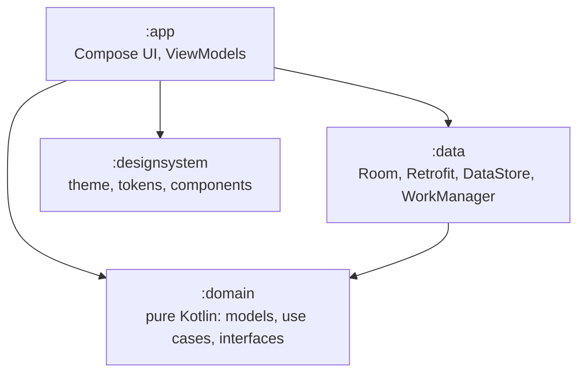

# FX Wallet


A multi-currency wallet for Android: accounts in several currencies, demo top-ups, currency exchange at current rates, and transaction history. Works offline on the last saved data.

> **Status:** in development (October 2026). Screenshots and a demo GIF come with the first release.

## Features

- First launch with a base currency and demo accounts
- Home: total balance in the base currency, account cards, recent transactions
- Top-up (demo money) and currency exchange with rate checks
- Transaction history with filters and search
- Offline-first: Room is the single source of truth; rates sync in the background via WorkManager
- Light and dark themes

Exchange rates: [Frankfurter](https://frankfurter.dev) (free, open-source, central bank data).

## Tech stack

Kotlin, Jetpack Compose, Material 3, Coroutines and Flow, RxJava 3 (debounced search), Hilt, Retrofit, Room, DataStore, WorkManager.

Tests: JUnit, MockK, Turbine, kotlinx-coroutines-test. Quality: ktlint, detekt, Android Lint, Kover.

## Architecture

Clean Architecture with MVVM + unidirectional data flow in the presentation layer. Layer boundaries are enforced by Gradle modules and Kotlin `internal` visibility.



Key decisions are recorded as ADRs:

- [ADR-001: Clean Architecture + MVVM, module structure and boundary enforcement](docs/adr/001-clean-architecture-mvvm-modules.md)
- [ADR-002: detekt 2.0 pre-release](docs/adr/002-detekt-2-pre-release.md)

## Build and run

Requirements: Android Studio (latest stable). Gradle downloads the JDK it needs.

```bash
./gradlew assembleDebug        # build the debug APK
./gradlew test                 # unit tests
./gradlew ktlintCheck detekt lint
./gradlew koverHtmlReportCoverage   # coverage: build/reports/kover/htmlCoverage/index.html
```

On Windows use `.\gradlew` instead of `./gradlew`.

## Author

Aleksandr Krichevtsov
